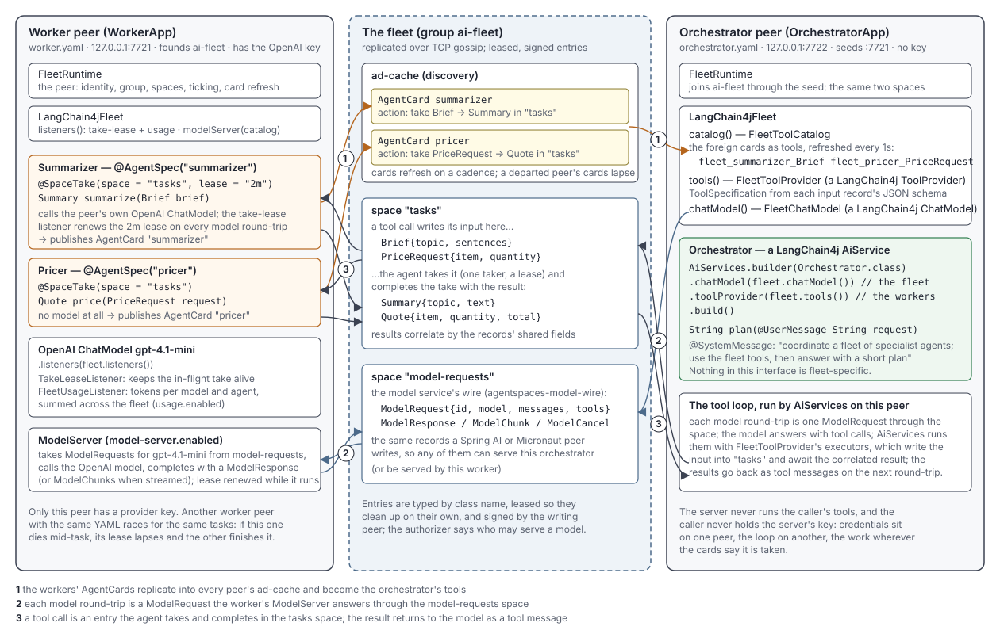

# Example 19: LangChain4j Fleet

Two plain-Java peers on one AgentSpaces fleet, with no application framework.
The **worker** binds two agents, a summarizer that uses the peer's own
LangChain4j model and a pricer that needs none, and serves that model to the
fleet. The **orchestrator** runs a LangChain4j `AiService` with no provider
key: its tools are the workers, live from their AgentCards, and its model is
the fleet, so every call travels through the space to the worker.

## How the pieces fit



Three kinds of things appear in the picture, and it helps to keep them apart:

- **Peers** are processes. Each runs a `FleetRuntime` built from its YAML
  (identity, the `ai-fleet` group, the `tasks` and `model-requests` spaces,
  ticking and card refresh) and a `LangChain4jFleet` over it. The worker
  founds the group and holds the only provider key; the orchestrator joins
  through the worker as its seed and holds no key.
- **Agents** are the worker's `@AgentSpec` beans, bound with
  `runtime.bind(...)`. Each `@SpaceTake` method is an action: the summarizer
  takes a `Brief` from `tasks` and completes it with a `Summary`, the pricer
  takes a `PriceRequest` and completes it with a `Quote`. Binding publishes an
  AgentCard per agent into the group's ad-cache, where every peer sees it and
  where it lapses when the worker leaves.
- **The AiService** is LangChain4j's, on the orchestrator, and nothing in its
  interface is fleet-specific. The fleet enters through the builder:
  `toolProvider(fleet.tools())` turns the foreign cards into tools
  (`fleet_summarizer_Brief`, `fleet_pricer_PriceRequest`, their schemas from
  the input records), and `chatModel(fleet.chatModel())` makes the fleet the
  model. `AiServices` runs the tool loop on the orchestrator as it would with
  any provider.

The numbered flows:

1. **Cards.** The worker's two AgentCards replicate into the orchestrator's
   ad-cache; `fleet.catalog()` turns them into the current tool set, refreshed
   every second, which the AiService sees on each call.
2. **Model round-trips.** Each call the AiService makes to its model is a
   `ModelRequest` written into `model-requests`; the worker's `ModelServer`
   takes it, calls the OpenAI model with the take lease renewed while it runs,
   and completes the take with a `ModelResponse` (or a stream of
   `ModelChunk`s). The records are `agentspaces-model-wire`'s, so a Spring AI
   or Micronaut peer could serve this orchestrator instead.
3. **Tool calls.** When the model answers with a tool call, the tool's
   executor writes the input (`Brief` or `PriceRequest`) into `tasks`; the
   agent takes it, the summarizer's own model call keeps that take alive
   through the take-lease listener, and the result (`Summary` or `Quote`)
   completes the take and correlates back by the fields the two records share.
   `AiServices` feeds it to the model as a tool message on the next round-trip,
   and the final answer is the plan.

Only the worker holds credentials; only the orchestrator runs the tool loop;
the work runs wherever the cards say it is taken. A second worker with the
same YAML races for the same tasks, which is what makes a dead worker's task
reappear and finish elsewhere.

## What it demonstrates

- `FleetRuntime` from one YAML file per peer: the same `agentspaces.*` keys
  the Spring Boot starter and the Micronaut library read.
- `LangChain4jFleet.tools()` on an `AiServices` builder: the model sees
  `fleet_summarizer_Brief` and `fleet_pricer_PriceRequest`.
- `model-server.enabled` on the worker and `model-client.enabled` on the
  orchestrator: `fleet.chatModel()` is the orchestrator's `ChatModel`.
- `@SpaceTake(lease = "2m")` on a worker that calls a model, with the
  take-lease listener on the model renewing the lease per round-trip.
- `usage.enabled`: token usage per model and agent on the worker.
- A worker that dies mid-task: its lease lapses and another worker finishes
  the task (the second test).

## The API in this example

| Where | What |
| --- | --- |
| `Workers.Summarizer`, `Workers.Pricer` | `@AgentSpec` + `@SpaceTake` in the take space `tasks`, bound with `runtime.bind(...)` |
| `Orchestrator` | an `AiService` interface with a `@SystemMessage`, nothing fleet-specific |
| `Peers` | the YAML document to a `FleetRuntime` and a `LangChain4jFleet` |
| `worker.yaml` | `model-server` and `usage` on; the worker brings `OPENAI_API_KEY` |
| `orchestrator.yaml` | `model-client` with `model: gpt-4.1-mini` and no key; a seed pointing at the worker |

## Running it

From `agentspaces-langchain4j/` with the libraries installed (`mvn install`),
and `OPENAI_API_KEY` set for the worker:

```sh
cd examples/langchain4j-fleet
mvn -q compile exec:java -Dexec.mainClass=ai.badmonkey.agentspaces.examples.langchain4j.WorkerApp
# in another terminal
mvn -q compile exec:java -Dexec.mainClass=ai.badmonkey.agentspaces.examples.langchain4j.OrchestratorApp
```

The orchestrator prints its plan and exits. The same orchestrator calls a
model a Spring AI peer or a Micronaut peer serves, and the reverse, because
the wire records are `agentspaces-model-wire`'s: start the Spring AI
example's model server (example 15) or the Micronaut one (example 17) in
the same group instead of this worker, and point `model-client.model` at
the model it serves.

The test, `LangChain4jFleetTest`, boots the two peers in one JVM over TCP on
free ports with a scripted model on the worker and asserts the loop: the
orchestrator's plan comes from both fleet tools, its model round-trips were
served through the space, usage was recorded, and a stuck worker's task is
finished by a healthy one after the lease lapses.

## Interoperability across JVMs and languages

`interop/ResearchWorker` is the research fleet's LangChain4j worker, a peer
in its own JVM that dials a coordinator and joins the group of the core's
example 02 (`research-fleet-demo-v1`) beside its Java, Python, and
TypeScript workers. `ResearchSchemas` names its records with the
coordinator's wire names, which is how two codebases agree on an entry type.
It takes `ResearchTask`s under the claim lattice, researches each with a
LangChain4j model whose take lease the fleet renews (a deterministic model
by default, OpenAI with `OPENAI_API_KEY`), completes with the `Finding` the
coordinator awaits, and serves its model to the fleet.

`CrossJvmInteropTest` is the automated proof. The test JVM runs the
coordinator rebuilt from the core API alone (`ResearchFleet` in the test
sources: plain TCP, its own record classes, the default naming, no part of
this library) and a keyless orchestrator on this library that joins through
it; it spawns the worker as a child JVM on the test classpath, and asserts
four things that cross the process boundary: the worker's AgentCard (seen by
the orchestrator as `fleet_researcher_ResearchTask`), the coordinator's
tasks completed with attested findings under the coordinator's names, a
tool call an `AiService` here makes to it, and a model call answered by the
model that lives over there. Six seconds, no provider key. The worker sets
`security.profile: dev-local`, since a peer that talks to a plain TCP
listener must not dial TLS, which the starter's default profile does.

The workspace's `run-trilingual-demo.sh` adds this worker as the fourth
runtime: a Java coordinator with Python, TypeScript, and LangChain4j workers
racing for six tasks on one space.
